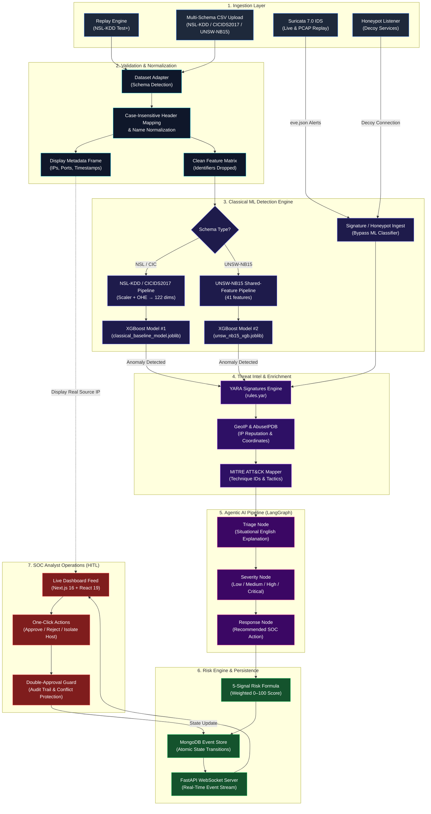

# 🛡️ SentinelAI

**An Agentic AI-Based Alert Triage & Response Assistant for Network Security**

[](https://github.com/Yateesh0313/-SentinelAI-An-Agentic-AI-Based-Alert-Triage-and-Response-Assistant-for-Network-Security/actions/workflows/ci.yml)
[](LICENSE)
[](https://python.org)
[](https://nextjs.org)
[](https://fastapi.tiangolo.com)
[](https://langchain-ai.github.io/langgraph/)
[](tests/)

> SentinelAI autonomously triages network intrusion alerts using an agentic AI pipeline—detecting anomalies with dual XGBoost models, enriching context with MITRE ATT&CK mapping, YARA signature matching, and IP reputation, then presenting risk-scored alerts to SOC analysts for human-in-the-loop approval—reducing mean-time-to-respond from hours to seconds.

**Basaveshwar Engineering College (Autonomous), Bagalkote**  
**Department of Computer Science & Engineering | Final Year B.E. Major Project | VTU 2027**  
📄 **Academic Documentation**: [Project Synopsis (Markdown)](docs/SentinelAI_Project_Synopsis_Updated.md) • [Project Synopsis (PDF)](docs/SentinelAI_Project_Synopsis_Updated.pdf) • [Team Contributions Matrix](TEAM_CONTRIBUTIONS.md)

---

## 📋 Problem Statement

Modern Security Operations Centers (SOCs) face an unsustainable influx of alerts:

- **11,000 alerts/day** hit the average SOC; analysts can only investigate a fraction (Devo, 2022 *SOC Performance Report*).
- **45% to 80% of daily alerts are false positives** (Ponemon Institute, *The Cost of Malware Containment*).
- **SOC analyst burnout exceeds 65%**, directly caused by alert fatigue (SANS 2023 *SOC Survey*).
- **Mean Time to Detect (MTTD)** a breach is **204 days** and Mean Time to Contain (MTTC) is **73 days** (IBM, *Cost of a Data Breach Report*).

Manual triage is the bottleneck. SentinelAI automates the initial 90% of investigation—detection, feature mapping, threat intelligence enrichment, LLM reasoning, and risk scoring—surfacing decision-ready incidents to human analysts to approve, reject, or isolate with full auditability.

---

## 🔄 Complete End-to-End System Workflow

The diagram below illustrates how raw events flow through ingestion, validation, dual-model ML inference, contextual enrichment, agentic AI reasoning, risk scoring, and human-in-the-loop governance:



---

## ⚙️ Detailed Flow of Each Stage

### 1. Ingestion & Multi-Format Adaptation
SentinelAI supports four parallel ingestion pipelines:
1. **Multi-Schema Dataset Upload (`/dataset/upload`)**: Allows SOC analysts to ingest network telemetry in multiple industry formats:
   - **NSL-KDD (41 canonical columns)**: Directly mapped.
   - **CICIDS2017 (80+ columns)**: Flow-meter headers mapped to canonical behavioral features.
   - **UNSW-NB15 (Full-File Layout - 49 columns)**: Detected case-insensitively (`srcip`, `sport`, `dstip`, `dsport`, `proto`, `state`, `dur`, `sbytes`, `dbytes`, `attack_cat`, `label`).
   - **UNSW-NB15 (Training-Set Layout - 45 columns)**: Detected case-insensitively.
2. **Canonical Normalization**:
   - Column renaming: `Sload`→`sload`, `Spkts`→`spkts`, `res_bdy_len`→`response_body_len`, `smeansz`→`smean`, `Sjit`→`sjit`, `Sintpkt`→`sinpkt`, etc.
   - Attack categories cleaned: whitespace stripped, spelling variants unified (`Backdoor` → `Backdoors`), blanks filled with `"Normal"`.
3. **Display vs. Feature Separation**:
   - High-cardinality identifiers (`srcip`, `dstip`, `sport`, `dsport`, `Stime`, `Ltime`, `id`, `rate`) are removed from model features to prevent overfitting or inventing artificial rate features.
   - IPs and ports are retained in a dedicated `display_df` so the SOC alert table clearly presents the real source IP (e.g. `59.166.4.14`).

### 2. Dual-Engine Machine Learning Detection
- **NSL-KDD / CICIDS2017**: Uses `classical_baseline_model.joblib` with `scaler.joblib` and `encoder.joblib` (41 features expanded to 122 one-hot encoded dimensions).
- **UNSW-NB15**: Uses the dedicated `unsw_nb15_xgb.joblib` retrained on the **41 shared features** of both UNSW layouts without `rate`.
  - Accuracy: **97.50%** | Precision: **98.36%** | Recall: **97.08%** | F1: **97.71%**.
- **Signature & Honeypot Ingestion**: Suricata `eve.json` alerts (Emerging Threats rules) and honeypot connections are already verified security events and bypass the statistical ML model directly to triage.

### 3. Contextual Enrichment & Threat Intelligence
- **YARA Signature Matching**: Scans packet metadata against custom `rules.yar` signatures (e.g., Mirai botnet headers, port sweeps, brute-force indicators).
- **IP Reputation & Geolocation**: Looks up the external or simulated source IP via AbuseIPDB and GeoIP for geographic coordinates and confidence scores.
- **MITRE ATT&CK Mapping**: Maps network behavior to ATT&CK Technique IDs (e.g., **T1498** Network DoS, **T1046** Network Service Scanning, **T1110** Brute Force, **T1041** Exfiltration Over C2).

### 4. LangGraph Multi-Agent Triage Pipeline
Built on **LangGraph** and powered by Groq LLMs (with deterministic rule-based heuristic fallbacks for high-throughput batch uploads):
1. **Triage Node**: Synthesizes event telemetry, protocols, and payload volumes into an intuitive plain-English narrative describing what occurred and why it is suspicious.
2. **Severity Node**: Assigns calibrated severity (`Low`, `Medium`, `High`, `Critical`) with explicit justification.
3. **Response Node**: Recommends defensive SOC actions (`block_ip`, `isolate_host`, `flag_for_review`, or `no_action`).

### 5. 5-Signal Deterministic Risk Scoring
Calculates a balanced composite risk score between 0 and 100 using a 5-signal weighted formula:

$$\text{Risk Score} = 0.30 \cdot S_{\text{ML}} + 0.25 \cdot S_{\text{LLM}} + 0.20 \cdot S_{\text{YARA}} + 0.15 \cdot S_{\text{Reputation}} + 0.10 \cdot S_{\text{Asset}}$$

- **$0–39$**: Low Risk (Monitor)
- **$40–69$**: Medium Risk (Flag for Review)
- **$70–84$**: High Risk (Immediate Analyst Triage)
- **$85–100$**: Critical Risk (Automated / Rapid Containment)

### 6. Human-in-the-Loop (HITL) Governance
- Alerts stream in real-time over WebSocket to the Next.js dashboard.
- SOC analysts can **Approve** (initiates containment action), **Reject** (marks as false positive), or **Investigate**.
- **Double-Approval Guard**: MongoDB atomic update guarantees that an alert cannot be approved or rejected more than once, returning HTTP `409 Conflict` on race conditions.

---

## 🛠️ Tech Stack

| Layer | Technology | Purpose |
|---|---|---|
| **Frontend** | Next.js 16, React 19, TypeScript, Tailwind CSS, shadcn/ui, Framer Motion | SOC dashboard, live alert table, MITRE view, dataset upload UI |
| **Backend** | FastAPI, Uvicorn, WebSockets, Pydantic | High-performance async REST API, real-time WebSocket broadcasting |
| **Agentic AI** | LangGraph, LangChain, Groq LLMs | Multi-agent reasoning pipeline (Triage, Severity, Response nodes) |
| **Detection Models** | XGBoost, scikit-learn, joblib | Production intrusion detection (`classical_baseline_model`, `unsw_nb15_xgb`) |
| **Threat Intel** | YARA, MITRE ATT&CK, AbuseIPDB, GeoIP | Contextual enrichment and signature matching |
| **IDS Engine** | Suricata 7.0, Emerging Threats Open | Live capture & PCAP replay (47,000+ signatures) |
| **Database** | MongoDB 7, Motor (async driver) | Document store for alert events, audit trails, and risk analytics |
| **Auth & Security** | JWT (HS256), passlib (bcrypt), RBAC | Role-based authentication (Viewer, Analyst, Admin) |

---

## 🚀 Quick Start Guide

### 1. Prerequisites
- **Python 3.10+**
- **Node.js 18+ LTS**
- **MongoDB 7+** (Local service or Docker)

### 2. Clone the Repository
```bash
git clone https://github.com/Yateesh0313/-SentinelAI-An-Agentic-AI-Based-Alert-Triage-and-Response-Assistant-for-Network-Security.git
cd -SentinelAI-An-Agentic-AI-Based-Alert-Triage-and-Response-Assistant-for-Network-Security
```

### 3. Start Database (Docker)
```bash
docker compose up -d
```
*Or ensure a local MongoDB instance is active on `mongodb://localhost:27017`.*

### 4. Backend Setup
```bash
cd backend
pip install -r requirements.txt
```

Create `backend/.env`:
```env
JWT_SECRET=your-super-secret-jwt-key-minimum-64-characters-long
RESEARCH_MODE=false
MONGODB_URI=mongodb://localhost:27017
ABUSEIPDB_API_KEY=your_abuseipdb_key_optional
```

Start the FastAPI server:
```bash
python -m uvicorn main:app --port 8000 --reload
```
API runs at **http://127.0.0.1:8000** (Swagger docs at `/docs`).

### 5. Agents Setup (Agentic Pipeline)
```bash
cd ../agents
pip install -r requirements.txt
```

Create `agents/.env`:
```env
GROQ_API_KEY=your_groq_api_key_here
GROQ_MODEL=qwen/qwen3.6-27b
```

### 6. Frontend Setup
```bash
cd ../frontend
npm install
npm run dev
```
Open **http://localhost:3000** in your browser.

### 7. Instant Demo Seeding
To populate the SOC dashboard with realistic, pre-triaged alerts across all severity tiers:
```bash
python scripts/seed_demo.py
```
This generates 28 curated events with MITRE ATT&CK tags, risk scores, and detailed triage summaries.

---

## 🔐 Role-Based Access Control (RBAC)

SentinelAI enforces role hierarchy across all API endpoints:

| Role | Permissions |
|---|---|
| **Viewer** | Read-only access to dashboard statistics, MITRE ATT&CK coverage, and public config. |
| **Analyst** | All Viewer privileges + Dataset Upload, Replay Controls, Alert Triage, Approve/Reject Actions. |
| **Admin** | All Analyst privileges + CSV Security Audit Logs, User Role Management, System Diagnostics. |

### Demo Data Seeding
To populate demo accounts and sample alerts, run `scripts/seed_demo.py`.

---

## 📡 REST API Reference

| Method | Endpoint | Min Role | Description |
|---|---|---|---|
| `POST` | `/auth/login` | Public | Authenticates user; returns JWT Bearer token |
| `POST` | `/auth/register` | Public | Registers a new SOC analyst user |
| `GET` | `/health` | Public | System health and loaded ML models status |
| `GET` | `/config/mode` | Public | Current operation mode (Demo vs Research) |
| `POST` | `/dataset/upload` | **Analyst** | Uploads & processes CSV datasets (NSL-KDD, CICIDS2017, UNSW-NB15) |
| `GET` | `/dataset/sample/{template}` | Public | Downloads reference templates (`nsl`, `cic`, `unsw`, `unsw_full`) |
| `GET` | `/events/pending` | **Authenticated** | Lists alerts awaiting SOC analyst action |
| `GET` | `/events/history` | **Authenticated** | Retrieves resolved/audited events |
| `POST` | `/events/{id}/approve` | **Analyst** | Approves recommended mitigation action |
| `POST` | `/events/{id}/reject` | **Analyst** | Rejects alert as false positive |
| `GET` | `/logs/csv/list` | **Admin** | Lists security log files available for export |
| `GET` | `/logs/download-csv` | **Admin** | Exports audit trail to CSV format |
| `WS` | `/ws` | **Authenticated** | Real-time WebSocket live alert stream (token query param required) |

---

## 🧪 Automated Test Suite

Run the full pytest suite:
```bash
python -m pytest tests/ -v
```

**57 automated tests passed (100% passing)** covering:
- Dual UNSW-NB15 schema detection (full 49-col layout and 45-col training layout).
- Normalization and sanitization of `attack_cat` and feature headers.
- Multi-role JWT authentication and RBAC boundary enforcement (401, 403, 200).
- Atomic state transitions protecting against race-condition double-approvals.
- YARA signature matches and MITRE ATT&CK heuristic mappings.
- 5-signal risk scoring boundary verifications.

---

## 👥 Team & Academic Context

**Basaveshwar Engineering College (Autonomous), Bagalkote**  
**Department of Computer Science & Engineering | Final Year B.E. Major Project | VTU 2027**

| Team Member | USN | Core Domain & Focus |
|---|---|---|
| **Yateesh Vijaykumar Mattur** | `2BA23CS125` | **Agentic AI & LLM Orchestration** (LangGraph, Groq, MITRE ATT&CK heuristics) |
| **Somashekhar Kadrolli** | `2BA23CS101` | **ML & Quantum Detection** (XGBoost, UNSW-NB15 models, PennyLane VQC R&D) |
| **Praveen Nashi** | `2BA23CS071` | **Backend & Security Integrations** (FastAPI, RBAC, Risk Engine, YARA, MongoDB) |
| **Dilip Holkar** | `2BA24CS402` | **Frontend UI/UX & Deployment** (Next.js 16, Tailwind CSS, WebSocket feed) |

---

## 📜 License

This project is licensed under the [MIT License](LICENSE).  
Copyright © 2026 SentinelAI Team.
